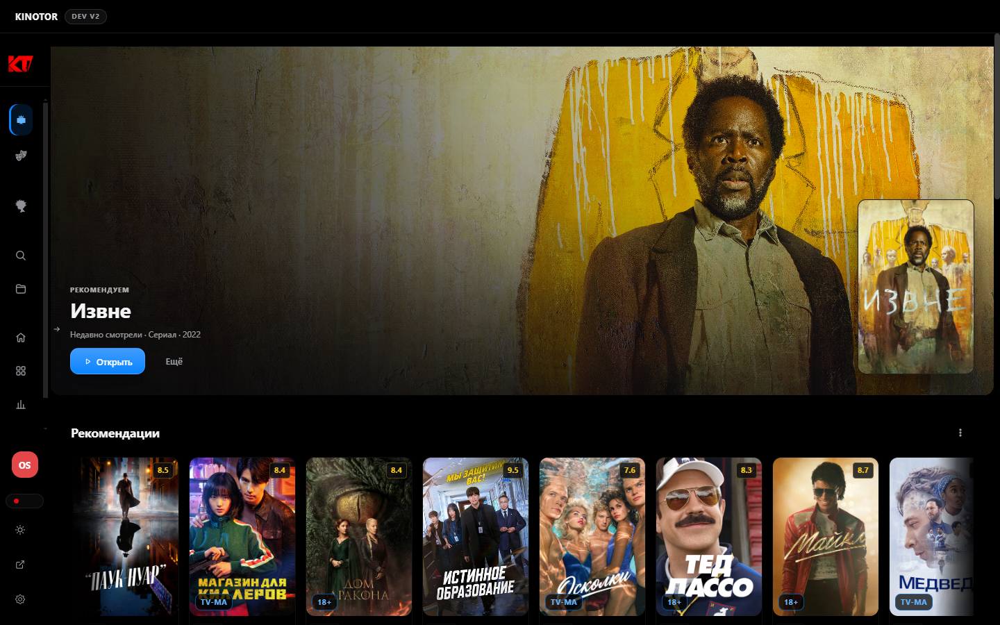
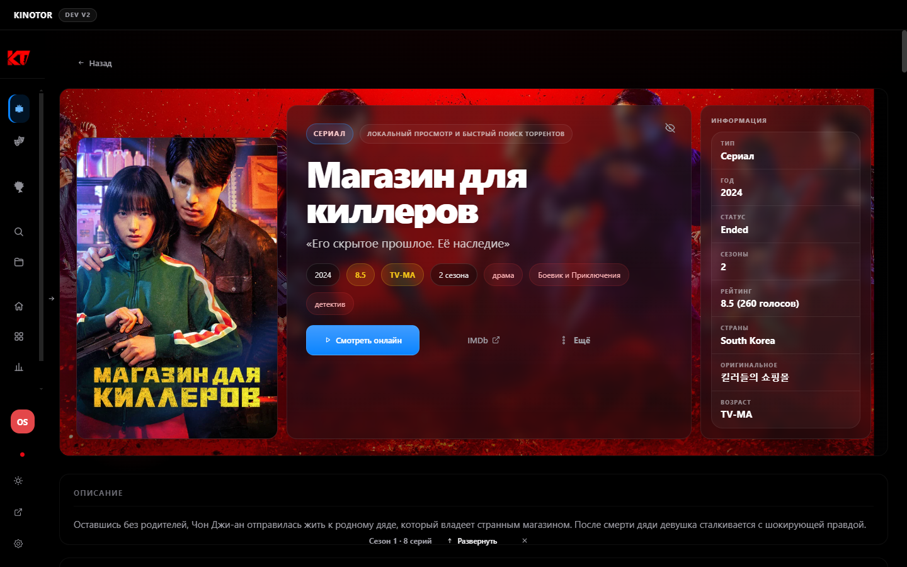
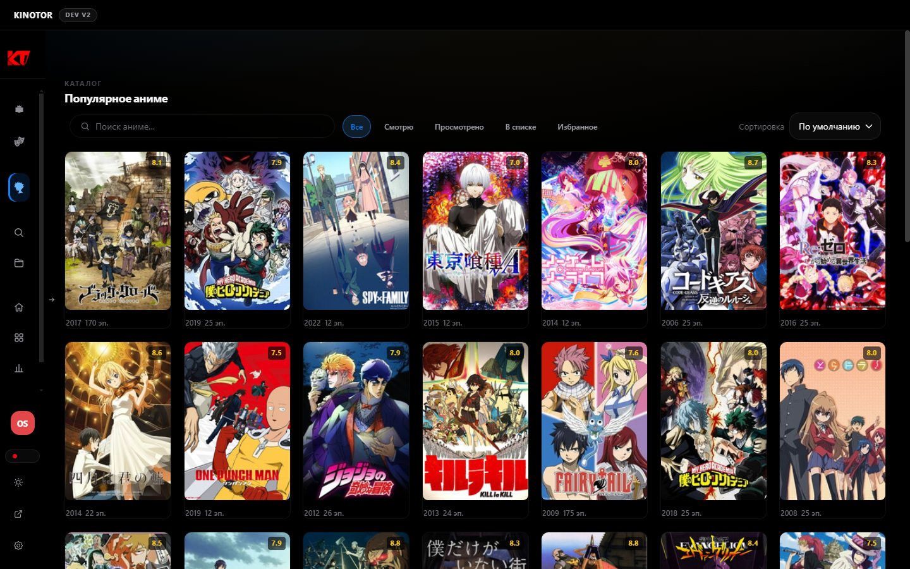
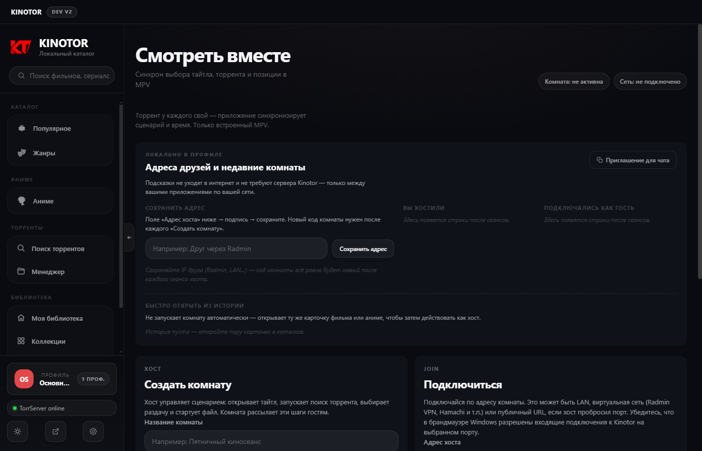
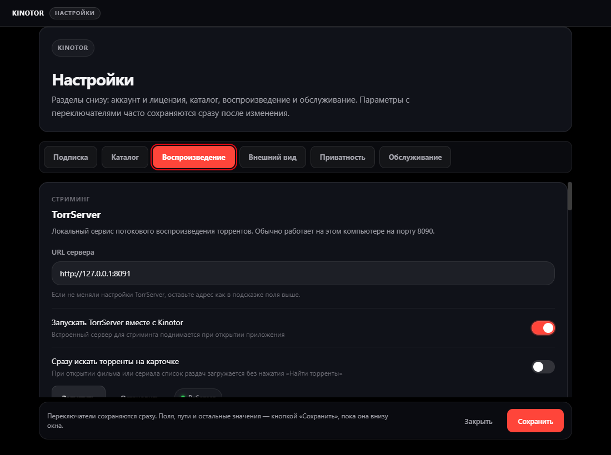

# Kinotor

**Фильмы, сериалы и аниме в одном приложении для Windows.**

Каталог, личная библиотека, онлайн-просмотр, поиск торрентов и совместный просмотр с друзьями.

[Скачать Kinotor](https://github.com/wendercurent/KINOTOR/releases/latest) · [Что нового](CHANGELOG.md) · [Руководство](docs/user-guide/getting-started.ru.md) · [English](README.en.md) · [Telegram](https://t.me/kinotorapp)

  

## Что такое Kinotor

Kinotor — бесплатный медиакаталог для Windows. Найдите фильм, сериал или аниме, сохраните его в библиотеку и выберите доступный способ просмотра. Приложение показывает сведения из TMDB и Shikimori и помогает продолжить просмотр с сохранённого места.

Для просмотра можно выбрать онлайн-источник или найти торрент на странице фильма. При просмотре торрента TorrServer загружает данные по частям и использует кэш: ждать полной загрузки файла заранее не обязательно. Доступность раздач, онлайн-источников, озвучек и субтитров зависит от сторонних сервисов и конкретного произведения.

## Скачать

**[Скачать последнюю версию для Windows](https://github.com/wendercurent/KINOTOR/releases/latest)**

- **Kinotor Setup** — установщик, рекомендуемый вариант.
- **Kinotor** — portable-файл, который можно запустить без установки.

Нужны Windows 10 или 11 x64, от 4 ГБ ОЗУ, около 500 МБ свободного места и интернет. Для кэша торрентов понадобится дополнительное место.

## С чего начать

1. Скачайте установщик со страницы релиза и запустите его, либо используйте portable-версию.
2. При первом запуске выберите язык и режим аудитории.
3. Найдите фильм, сериал или аниме и откройте карточку.
4. Нажмите **«Смотреть онлайн»** или **«Найти торренты»**. Для просмотра торрента выберите раздачу и плеер.

TorrServer обычно запускается вместе с приложением; его параметры находятся в **Настройки → Воспроизведение**. В безопасном режиме торрент-функции отключены. Подробности — в [руководстве](docs/user-guide/getting-started.ru.md) и [ответах на вопросы](docs/user-guide/faq.ru.md).

## Возможности

- **Каталог фильмов и сериалов:** поиск, жанры, подборки, актёры и рекомендации.
- **Аниме:** каталог, сезоны, расписание и список серий.
- **Способы просмотра:** онлайн-источники, торренты, встроенный плеер и внешние плееры, включая MPV и VLC.
- **Личная библиотека:** избранное, список на потом, история и прогресс просмотра.
- **Совместный просмотр:** синхронизация выбора и позиции с друзьями при доступности соединения.
- **Дополнительный поиск торрентов:** при желании можно подключить свой Jackett или Prowlarr в настройках.
- **Удобство:** субтитры, статистика, темы и случайный выбор фильма.

Базовые функции бесплатны. Поиск торрентов по произвольному запросу и дополнительные профили относятся к полной версии; подробности — в [Telegram](https://t.me/kinotorapp).

## Скриншоты

| Главная | Карточка фильма или сериала |
|:---:|:---:|
|  |  |

| Аниме | Совместный просмотр |
|:---:|:---:|
|  |  |

## Проверка файлов

Приложение пока не имеет цифровой подписи. Скачивайте его из [официальных релизов](https://github.com/wendercurent/KINOTOR/releases) и сверяйте SHA-256 со страницей релиза.

Отчёты VirusTotal для v0.1.6: [установщик](https://www.virustotal.com/gui/file/41ac7f20ba0389fe04d9399f0be8afbe9fd0bd38aae42611c0dfa290e17f5835) · [portable](https://www.virustotal.com/gui/file/f11848bd9f9f4f41f0b862b04ed9c78c81b4e557c3464163b1ee5a06b96f2fe2). При последней проверке portable-файл отмечен одним из 67 движков; причина не установлена. Изучите отчёты перед запуском: совпадение хеша само по себе не гарантирует безопасность.

## Вопросы и поддержка

- Не запускается TorrServer? Проверьте **Настройки → Воспроизведение**, автозапуск и доступность указанного порта.
- Нет постеров или результатов поиска? Проверьте подключение к интернету и настройки каталога; доступность сторонних сервисов может меняться.
- Не находится торрент или онлайн-вариант? Попробуйте другое название или источник. Опционально подключите Jackett или Prowlarr.
- Нашли ошибку? Откройте [Issues](https://github.com/wendercurent/KINOTOR/issues) или напишите в [Telegram](https://t.me/kinotorapp).

В репозитории опубликованы документация и сборки приложения; исходный код закрыт. Условия распространения — в [LICENSE](LICENSE). Kinotor находится в стадии публичной беты. Используйте только контент, доступный вам на законных основаниях.

